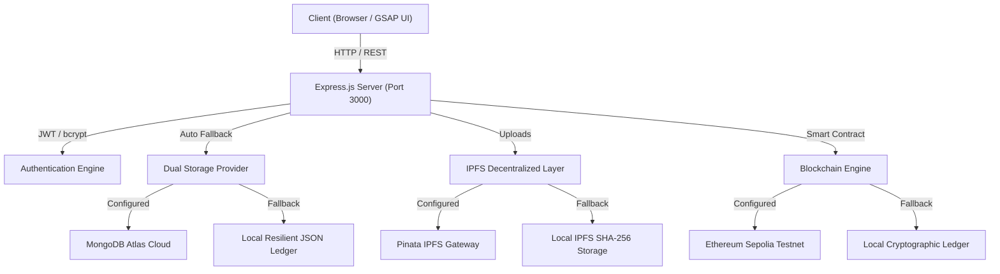

# Whiskey Vault 🥃
**Decentralized Provenance & Cask Authentication Vault on Ethereum & IPFS**

Whiskey Vault is a luxury decentralized document and asset authentication platform tailored specifically for rare vintage whiskies, single malt casks, distillery archives, and high-value spirit investments.

By anchoring legal cask ownership deeds, laboratory chemical assay certificates, spectrometer fingerprints, and bottle serial numbers to Ethereum smart contracts and IPFS decentralized storage, Whiskey Vault eliminates counterfeiting risks and provides an unbroken, cryptographic chain of custody.

---

## 🌟 Key Features

- **🥃 Immutable Cask & Bottle Provenance**: Cryptographically register single malts, aged barrels, bottle serial numbers, and master blender release certificates.
- **⛓️ Smart Contract Notarization**: Every record is timestamped and recorded on the Ethereum blockchain with immutable transaction hash and block confirmation.
- **📦 Decentralized IPFS Storage**: Certificates and deeds are pinned to IPFS with deterministic SHA-256 multihashes, guaranteeing permanence without single points of failure.
- **🛡️ Built-in Offline & Local Fallback Engine**: Seamless execution out-of-the-box. The application gracefully runs with an embedded cryptographic ledger and local IPFS storage if external cloud services (MongoDB/Pinata/Infura) are not configured.
- **🔍 Advanced Provenance Search & Inspection**: Debounced search and filtering by distillery (The Macallan, Springbank, Yamazaki, Bowmore, etc.), vintage, cask category, and blockchain hash.
- **🎨 Luxury Amber & Aged Oak Theme**: Bespoke visual design with warm amber spirits canvas, interactive golden vapors, and glassmorphic UI.
- **🔐 Secure Authentication**: JWT session management with bcrypt-salted password hashing and role-based permissions.

---

## 🏛️ System Architecture



---

## 🚀 Quick Start

### 1. Prerequisites
- **Node.js**: v18.x, v20.x, or v22.x
- **npm**: v9.x+

### 2. Installation
```bash
git clone https://github.com/Karanxc/EVault.git "Whiskey Vault"
cd "Whiskey Vault"
npm install
```

### 3. Environment Configuration (Optional)
The project works immediately with zero configuration! If you want to connect live cloud services, copy `.env.example` to `.env`:

```bash
cp .env.example .env
```

Environment variables supported:
```ini
PORT=3000
JWT_SECRET=whiskey_vault_super_secure_jwt_secret_key_2026

# Optional: MongoDB URI (leave empty for local file ledger)
MONGODB_URI=

# Optional: Pinata IPFS API Keys (leave empty for local IPFS hash storage)
PINATA_API_KEY=
PINATA_API_SECRET=

# Optional: Ethereum Web3 (leave empty for local blockchain ledger)
INFURA_ENDPOINT=
PRIVATE_KEY=
CONTRACT_ADDRESS=
```

### 4. Run Server
```bash
npm start
```
Open your browser and navigate to: **`http://localhost:3000`**

### 5. Run Verification Test Suite
```bash
npm test
```

---

## 📜 Smart Contract

The Solidity smart contract `contracts/WhiskeyVault.sol` (and `DocumentVault.sol`) manages immutable provenance records:

```solidity
function uploadDocument(
    string memory ipfsCid,
    string memory title,
    string memory description,
    uint256 size,
    uint256 timestamp,
    string memory author,
    string memory tags,
    string memory blockHash,
    string memory txHash
) public returns (uint256);

function getDocument(uint256 id) public view returns (...);
function getDocumentCount() public view returns (uint256);
```

---

## 📡 API Reference

| Endpoint | Method | Description | Auth |
| :--- | :--- | :--- | :--- |
| `/api/health` | `GET` | Service health and active storage/blockchain mode | Public |
| `/api/stats` | `GET` | Vault metrics (total items, casks, bottles, distilleries) | Public |
| `/api/search` | `GET` | Query all authenticated whiskey records | Public |
| `/api/document/:id` | `GET` | Retrieve record by ID with full provenance details | Public |
| `/api/signup` | `POST` | Register new collector or distillery account | Public |
| `/api/login` | `POST` | Sign in and receive JWT token | Public |
| `/api/me` | `GET` | Retrieve authenticated user profile | Bearer JWT |
| `/api/upload` | `POST` | Upload certificate file and notarize on blockchain | Bearer JWT |
| `/ipfs/:cid` | `GET` | Stream/download decentralized certificate file | Public |

---

## 🛡️ License

This project is licensed under the [MIT License](LICENSE).
Created with craft by **Karan Chhatral**.
